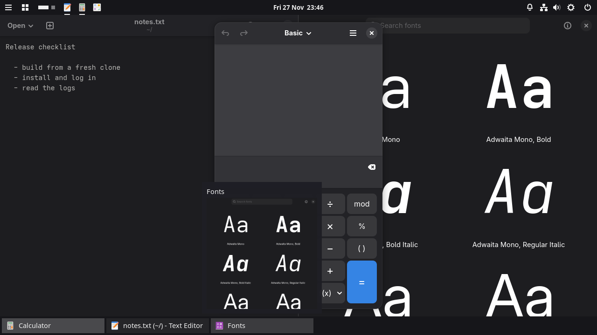
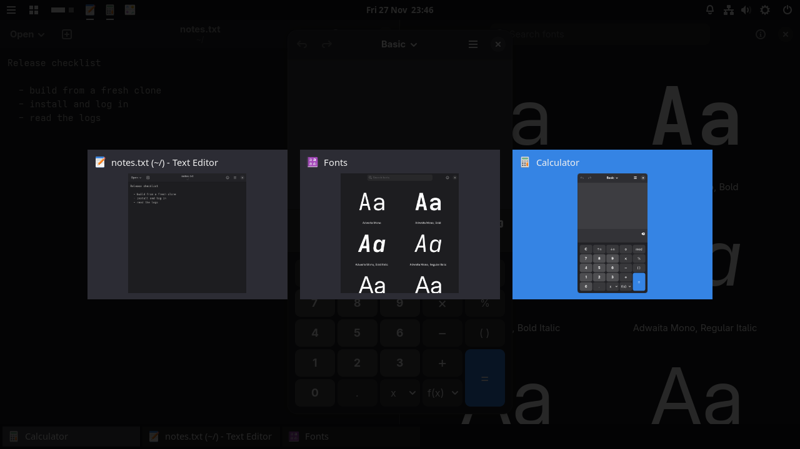
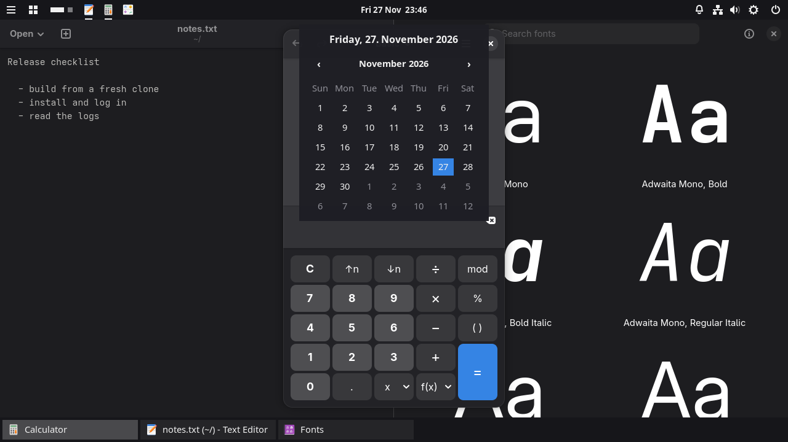
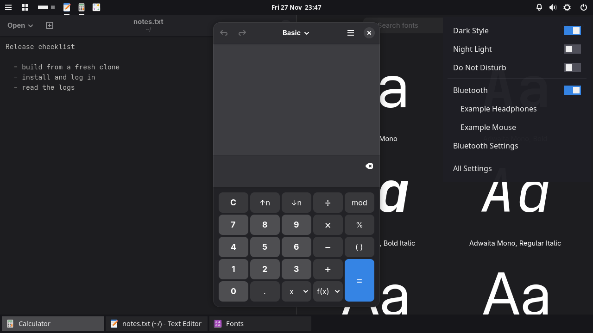

# gnutshell

A GNOME-style shell written in Rust, running directly on **libmutter**: no GJS, no JavaScript.

gnutshell replaces the `gnome-shell` binary. It creates a `MetaContext` and registers a
Rust GObject subclass of `MetaPlugin` as the compositor plugin. Then it runs mutter's
main loop. Mutter handles compositing, Wayland, KMS, input and window management. gnutshell
supplies the shell: the UI drawn with Clutter, plus window effects.



| Window overview | Calendar | Quick settings |
|---|---|---|
|  |  |  |

(Taken in a headless test session; the Bluetooth devices are made up.)

## Status

Early software (0.1.2). It has been used on a single PC: CachyOS (based on Arch
Linux) with mutter 51.1 and one monitor at 150 % scale; connecting and
disconnecting a real Bluetooth device works there. Several monitors and suspend
and resume are untested, and so are other distributions. It runs only with
**mutter 51**. Keep GNOME installed: if gnutshell fails, pick GNOME on the
login screen.

## Install

On Arch Linux and distributions based on it. First what building needs:

```sh
sudo pacman -S --needed base-devel git rust mutter polkit cairo librsvg glycin systemd-libs libpulse
```

Then what a session needs:

```sh
sudo pacman -S --needed gnome-session gnome-settings-daemon gsettings-desktop-schemas adwaita-icon-theme pipewire-pulse xdg-desktop-portal-gnome
```

Pacman installs some further parts by itself, among them Xwayland for X11 apps
such as Steam, GNOME Settings, and UPower for the battery icon.

Optional packages. Each one adds what the second column names. gnutshell runs
without it; only that feature is then missing.

| Package | Adds |
|---|---|
| `gnome-backgrounds` | GNOME's default wallpapers |
| `gcr` | keyring password prompts |
| `gnome-shell` | the screenshot keys (only its settings schema is used) |
| `bluez` | Bluetooth in quick settings |
| `networkmanager` | the network icon |

**The install script changes system files with `sudo`:** it adds the program,
a login session, a PAM configuration for the lock screen and systemd user units
under `/usr` and `/etc`. Read [`dist/install.sh`](dist/install.sh) before you
run it. There is no warranty (see [License](#license)).

Build and install, as your normal user (the script asks for `sudo` itself; the
build needs Rust 1.92 or newer):

```sh
git clone https://github.com/miklo187/gnutshell.git
cd gnutshell
dist/install.sh
```

Log out and pick **gnutshell** on the GDM login screen. To remove it again, run
`dist/install.sh uninstall`. What the script installs is listed under
[Run](#run).

First steps: press Super or click ☰ for apps. Right-click a window title or a
taskbar entry to pin its app. Right-click empty taskbar space to group windows.
Logs: `journalctl --user -u gnutshell.service -b`.

## Current features

- Desktop background from `org.gnome.desktop.background`: the picture on every
  monitor with your `picture-options` (zoom, scaled, centered, stretched,
  wallpaper or spanned), or a solid color or gradient. With the dark style it
  shows `picture-uri-dark`. Changes in Settings apply at once. Pictures are
  decoded with glycin, as in gnome-shell (JPEG, PNG, JPEG XL, SVG and the
  other formats your glycin loaders support); if one can't be read, the colors
  show. Slideshows described by XML files and the crossfade between pictures
  are not supported, and a file that changes under the same name is not
  reloaded.
- Top panel with a centered clock. The panel reserves screen space through workspace
  struts, so maximized windows stay below it. The panel hides when the primary monitor
  shows a fullscreen window.
- Taskbar: a bar along the bottom of the primary monitor with one entry per
  open window, from all workspaces, oldest first. Click an entry to focus the
  window (switching workspace if needed), or to minimize it if it already has
  the focus. Minimized windows are dimmed. Rest the pointer on an entry for a
  live preview of the window. Entries shrink as windows are added, down to
  icons only; the bar does not scroll. Like the panel, it reserves screen space
  and hides when the primary monitor shows a fullscreen window.
- Pinned apps, as shortcuts on the taskbar and on the top bar: choose "Pin to
  Top Bar" or "Pin to Taskbar" in the window menu of a running app, or
  right-click an app in the app launcher. The launcher's menu also has Open (or
  Open New Window); after pinning, the launcher stays open. On the
  taskbar, pinned apps come first, in the order pinned. Without a window, a
  pinned app is an icon that starts it (hover shows its name); while it has
  windows, their entries take that place. On the top bar, pinned apps are
  icons right of the workspace dots, with a line under those that are running.
  A click starts the app, focuses the window of it used last, or minimizes that
  window if it already has the focus. Shift+click or Ctrl+click on a top bar
  shortcut or a taskbar entry opens a new window of the app, through its
  "new window" desktop action if it has one; an app without one decides what
  starting it again does. Right-click a shortcut for Open (Open New
  Window while it runs) and the unpin entries. The list is stored in
  `~/.config/gnutshell/pinned.ini`; it is not GNOME's dash favorites.
  Drag a pinned icon, or a window entry of a pinned app, along its bar to
  reorder; a line shows where it will land, and releasing it far from the bar
  changes nothing. The two bars keep separate orders. Windows of apps that are
  not pinned can't be moved, and nothing is dragged from one bar to the other.
  A window that matches no desktop file can't be pinned. Top bar
  shortcuts that would reach the clock are not shown.
- Window menu: right-click a title bar, press Alt+Space
  (`activate-window-menu`) or right-click a taskbar entry. It offers Minimize,
  Maximize/Restore, Always on Top, Always on Visible Workspace, Move to
  Workspace Left/Right, the pin entries and Close; the view does not follow a moved window.
  Always on Top is grayed out while the window is maximized, because mutter
  does not keep a maximized window above others. Mouse or keyboard (Up/Down,
  Enter, Escape). There are no entries for moving or resizing, for other
  monitors or for screenshots. An app that draws its own title bar and does not
  ask for this menu has it only through the other two ways. Tiles in the
  window overview have no menu.
- Grouped taskbar, off by default: right-click an empty part of the taskbar and
  switch "Group Windows" on. The bar then has one icon per app, over a line
  that is blue when the app has the focus and in two pieces when it has several
  windows; pinned apps stay first. Rest the pointer on an icon to see all of
  the app's windows side by side: click one to go to it, ✕ or a middle click to
  close it, right-click for its window menu. A click on the icon focuses or
  minimizes the app's only window, or shows the choice if there are several.
  Right-click an icon with several windows for Open New Window, the pin entries
  and Close All Windows (the menus of top bar shortcuts and launcher entries
  have the latter too). Windows that match no desktop file are not grouped.
  Many windows make narrow previews; they do not scroll. The setting is stored
  with the pins.
- Window overview: the four-square button at the left of the panel shows every
  open window, from all workspaces, as a tile with a live picture. Click a tile
  or use the arrow keys and Enter; Escape or a click outside closes it. When
  the tiles do not fit, scroll with the wheel or touchpad, or drag the
  scrollbar. It has no keyboard shortcut.
- Session menu: a power button at the right of the panel opens Lock, Suspend,
  Restart, Power Off and Log Out. Mouse or keyboard (Up/Down, Enter,
  Escape). Lock and Suspend act at once; actions that logind reports as
  unavailable are hidden. Restart, Power Off and Log Out go through
  gnome-session, which asks running apps first and then has gnutshell show a
  confirmation (`org.gnome.SessionManager.EndSessionDialog`). It names the
  apps that block logging out and why. With blockers, the button reads
  "… Anyway" and Enter cancels. `gnome-session-quit` gets the same dialog.
  There is no countdown: nothing happens until you answer. As in gnome-shell,
  setting `org.gnome.SessionManager logout-prompt` to `false` skips the dialog
  when nothing blocks. Without gnome-session, gnutshell confirms by itself,
  sends Restart and Power Off to systemd-logind and ends itself for Log Out.
  logind can ask for a password through gnutshell's polkit agent (for example
  when other users are logged in).
- Notifications: gnutshell is the `org.freedesktop.Notifications` service. A
  banner below the right end of the panel shows the icon or image, app name, title, up to three
  lines of text and up to three action buttons. Click the banner for the default
  action, ✕ to dismiss it, or the copy button to put the title and full body
  on the clipboard. One banner shows at a time and the rest queue.
  Banners hide after 5 s (or the app's timeout, at most 30 s), and stay while
  the pointer is over them; critical ones stay until dismissed. Nothing shows
  on the lock screen; waiting notifications show after unlock. Over a
  fullscreen window only critical ones show. With Do Not Disturb
  (`org.gnome.desktop.notifications show-banners` off), other notifications are
  not shown as banners.
- While a program that sent a notification is still on the session bus, only it
  can replace or close it, as in gnome-shell; afterwards others can, so that a
  second `notify-send -r` works. No program can replace or close gnutshell's own
  notifications or show them under gnutshell's name.
- Notification settings and sounds: the per-app switches in GNOME Settings
  work. An app that is off is neither shown nor listed, one with banners off
  only goes to the list, and critical notifications still show a banner then.
  gnutshell adds installed apps to that list when they first notify, matched
  by the `desktop-entry` hint or else by name. A notification plays a sound
  only if it asks with `sound-name` or `sound-file`, and not with
  `suppress-sound`, system event sounds off, the app's sound alerts off, or
  when it gets no banner because of Do Not Disturb or the app's settings.
  The lock screen, pop-up expansion and lock screen detail settings have
  nothing to act on.
- Notification list: click the bell at the right of the panel, left of the
  keyboard layout indicator. It keeps notifications whose banner timed out,
  including ones hidden by Do Not Disturb, newest first. The bell is blue while
  there are unread ones, and crossed out with Do Not Disturb. Each entry has a
  copy button and ✕; "Clear all" empties the list. Scroll or use Up/Down; when
  entries do not fit, a line below says how many more there are, and a click on
  it moves down by a screenful. Escape or a click outside closes it. Dismissed,
  clicked and app-withdrawn notifications are not listed, nor are `transient`
  ones. While the list is open, new notifications appear in it instead of as
  banners. It holds up to 50 entries in memory, so logging out clears it.
  Entries have no pictures or actions.
- Calendar: click the clock for a month view. Month and day names and the first
  day of the week follow your `LC_TIME` locale, and week numbers (ISO) show if
  `org.gnome.desktop.calendar show-weekdate` is on. Change the month with ‹ ›,
  Left/Right or by scrolling; click the date at the top or press Home to return
  to today. Banners wait while it is open. It shows no events, and clicking a
  day does nothing.
- Screenshots: `Print` dims the screen; drag to take that area, press Enter
  for the whole screen or Escape to cancel. `Shift+Print` takes the whole
  screen and `Alt+Print` the focused window. The keys come from
  `org.gnome.shell.keybindings`. Each one saves a PNG in
  `Pictures/Screenshots`, copies the image to the clipboard and shows a
  notification. gnutshell also provides `org.gnome.Shell.Screenshot` for the
  GNOME portal and gsd-media-keys. As in gnome-shell, only the owners of the
  portal's and gsd-media-keys' bus names may call it, and not while the screen
  is locked; `org.gnome.Screenshot`, and so the `gnome-screenshot` tool, is
  not allowed. A file name given to it must be a plain name, which never
  overwrites, or an absolute path, which replaces what is there, as in
  gnome-shell. With `org.gnome.desktop.lockdown disable-save-to-disk` on,
  nothing is saved: the keys only copy, and the methods that save refuse.
  While selecting, `P` puts the pointer in the picture, where it was when you
  pressed `Print`; the other keys leave it out. The captured area flashes,
  unless animations are off. The API also does color picking: the pixel under
  a click, with a preview of the color and its hex code next to the pointer.
- Quick settings: the gear button left of the power button opens switches for
  the dark style (`color-scheme`), night light and Do Not Disturb. They change
  the GNOME settings, so GNOME Settings shows the same. Night light still
  follows its schedule, which the menu names while it is on. With a Bluetooth
  adapter (through BlueZ) there is also a Bluetooth switch and the paired
  devices: click one to connect or disconnect it. Pairing needs "Bluetooth
  Settings"; gnutshell has no pairing agent of its own. "All Settings" opens
  GNOME Settings.
- Status icons left of the quick settings button: network, volume and, if UPower
  reports a battery, battery with its percentage. Scroll over the volume icon
  to change the default output's volume in steps of 5 % (up to 100 %), and
  middle-click it to mute. A left click on the network or battery icon opens
  the matching page of GNOME Settings. Volume comes from libpulse (PipeWire
  works), network from NetworkManager, battery from UPower. An icon whose
  service is missing is hidden. There is no network or power menu.
- Volume menu: a left click on the volume icon opens a mute button, a slider
  (click, drag, scroll or Left/Right), the audio outputs and a link to Sound
  Settings. Outputs are sound card ports such as speakers, headphones or an
  HDMI monitor, plus sinks without a card. Ports known to be unplugged are
  hidden. Choosing a port that the card's current profile lacks switches the
  profile, keeping the current input if possible. If there is a
  microphone, the menu has the same for it below: a mute button, a slider
  (click, drag or scroll) and the inputs, switched like outputs. Left/Right and
  scrolling elsewhere in the menu change the output. The panel does not show
  whether the microphone is in use. Per-app volumes are not in the menu. Escape or a click outside closes it.
- Window effects: fade/scale on map, destroy, minimize and unminimize
- App launcher: press Super, or click the three-bar button at the left end of
  the panel, to open a search field over a dimmed screen. Type to
  filter installed apps. Scroll with the mouse wheel or touchpad; use Up/Down or Tab to select, and Enter or a click to
  launch. Escape, Super or a click outside the box closes it. Apps launch through
  mutter's `MetaLaunchContext`, so they get the correct `WAYLAND_DISPLAY`/`DISPLAY`
  and an activation token. Set `GNUTSHELL_LAUNCHER=<command>` to run an external
  launcher instead.
- Runs as a full GNOME session on gnome-session, like gnome-shell does, as the
  systemd user unit `gnutshell.service`. gnome-session starts
  gnome-settings-daemon (power, color/night light, keyboard, media keys,
  housekeeping, …) and the autostart apps.
- X11 apps: when mutter starts Xwayland, gnutshell starts gnome-session's X11
  services (`gnome-session-x11-services-ready.target`), as gnome-shell does.
  Their gsd-xsettings gives X11 apps such as Steam the font DPI for the monitor
  scale, plus fonts, theme and cursor size. Nested and console runs have no
  such services.
- Media keys and custom shortcuts: gnutshell provides the accelerator part of
  gnome-shell's `org.gnome.Shell` D-Bus API, which gsd-media-keys uses to bind
  volume, brightness, media and custom shortcut keys. As in gnome-shell, only
  gsd-media-keys, GNOME Settings and the GNOME portal may call it, and a client's
  grabs are released when it leaves the bus.
- On-screen display (`ShowOSD`): the volume/brightness popup, with a level bar
  and an over-amplification mark.
- Keyboard layouts from Settings (`org.gnome.desktop.input-sources`): up to 4
  XKB layouts, Super+Space / Shift+Super+Space to switch, the active layout
  shown in the panel (click to switch). The last used layout is remembered in
  `mru-sources`, as in gnome-shell. IBus input methods are not supported yet.
- Lock screen: Super+L (through gnome-settings-daemon and
  `org.gnome.ScreenSaver.Lock`), "Lock" in the session menu, or
  `loginctl lock-session`; also on idle and before suspend when
  `org.gnome.desktop.screensaver lock-enabled` is on (after `lock-delay`).
  The password is checked by PAM (service `gnutshell`, falling back to `login`)
  on a worker thread. While locked, windows are hidden and unredirection is
  off, every shortcut is blocked except VT switching, layout switching and
  media keys that gsd allows on the lock screen, and polkit prompts wait.
  logind's LockedHint and `ActiveChanged` are kept up to date.
- Workspaces: a panel indicator on the left, next to the launcher and overview buttons (one dot per workspace, the
  active one wider; click a dot to switch, scroll over it to step), and a
  slide animation when switching (Super+PageUp/PageDown, Ctrl+Alt+arrows and
  the other mutter workspace shortcuts). With `org.gnome.mutter
  dynamic-workspaces` on, workspaces are managed like in gnome-shell: always
  one empty workspace at the end, at least two, empty ones in between are
  removed, the active one is kept. With it off, mutter's fixed
  `num-workspaces` applies.
- App icons in the launcher and the switcher. Icons are looked up per the
  freedesktop icon theme spec: your `icon-theme` setting, its `Inherits`
  chain, `hicolor`, then `/usr/share/pixmaps`. They are rendered with
  librsvg/cairo, with no GTK and no gdk-pixbuf, and cached as GPU textures.
  Changing the icon theme takes effect live. In the switcher, each window is
  matched to its app by sandboxed/GTK application id, Wayland app id or
  `WM_CLASS`, or a desktop file's `StartupWMClass`.
- Window switcher: Alt+Tab or Super+Tab (your `switch-applications`/`switch-windows`
  keybindings) shows the windows of the current workspace as live tiles, like
  the window overview, in most-recently-used order. Tab and Shift+Tab cycle and
  the arrow keys move in the grid. Releasing the modifier activates the
  selection, and Escape cancels. The tiles appear only after 120 ms, so a quick
  Alt+Tab just flips windows. This version lists windows, not apps grouped by
  window.

- Polkit authentication agent: a modal "Authentication Required" dialog for
  `pkexec`, software installs, system settings and similar. It drives
  libpolkit-agent-1's `PolkitAgentSession`, which runs the setuid PAM helper.
  The password goes from the entry straight to that helper and is never stored.
  Supports retry after a wrong password, Escape/Cancel, multiple requests in a
  queue, and cancellation from polkitd. The current user is preferred as the
  identity when polkit offers it.

## Build

Requires mutter 51 development files (`libmutter-51.pc`), polkit
(`polkit-agent-1.pc`), cairo, librsvg, glycin (`glycin-2.pc`), libsystemd, libpulse with its GLib
main loop (`libpulse-mainloop-glib.pc`) and Rust 1.92 or newer; see
[Install](#install) for package names. Running it as a session needs
gnome-session and gnome-settings-daemon.

```sh
cargo build --release
```

## Run

**Nested, inside your current session.** The private D-Bus session avoids clashing
with the running gnome-shell's bus names:

```sh
dbus-run-session -- ./target/release/gnutshell --wayland --devkit
```

Clients connect via the Wayland display name printed in the log, for example:

```sh
WAYLAND_DISPLAY=wayland-1 kgx
```

**Headless smoke test:**

```sh
./target/release/gnutshell --wayland --headless --virtual-monitor 1280x720 --wayland-display gnutshell-test
```

**Launcher test without input devices** (debug builds only). This opens the launcher,
types the query, and launches the top match:

```sh
GNUTSHELL_DEBUG_LAUNCH=console dbus-run-session -- ./target/debug/gnutshell --wayland --headless --virtual-monitor 1280x720
```

**Polkit agent while nested.** Your gnome-shell already owns the agent for the
login session, so a nested gnutshell registers only for one process. Start gnutshell
from one terminal, then run `pkexec` from another:

```sh
# terminal A: note this shell's PID
echo $$
# terminal B
GNUTSHELL_POLKIT_PID=<pid from A> dbus-run-session -- ./target/release/gnutshell --wayland --devkit
# back in terminal A: the dialog appears inside gnutshell
pkexec true
```

A headless test that never types a password: register for a test shell, run
`pkcheck --action-id org.freedesktop.policykit.exec --process $$ --allow-user-interaction`,
and send Escape with `GNUTSHELL_DEBUG_KEYS`. `pkcheck` exits with 3 (dismissed).
Don't script wrong passwords: `pam_faillock` locks the account after 3 failures.

**Keyboard-driven test** (debug builds only): `GNUTSHELL_DEBUG_KEYS="<ms>:<tokens>"`
types through a virtual keyboard after `<ms>`, one token every 80 ms. Tokens are
characters to type, `Super`, `Return`, `Escape`, `Tab`, `Up`, `Down`, `Alt+Tab`, `Alt-down` /
`Alt-up` (hold or release Alt), raw keysyms `0x…` (tap) or `down:0x…` / `up:0x…`, pointer `move:X,Y`, `click`, `middle-click`, `right-click`, `press` / `release`, `wheel-up` / `wheel-down`, and `_` (pause). `GNUTSHELL_DEBUG_SCREENSHOT="<ms>,...:<prefix>"`
saves raw BGRA screenshots at those times.

`GNUTSHELL_DEBUG_PAM_USER=<user>` checks lock screen passwords against another
(e.g. nonexistent) user, so test attempts never count against your account.
`GNUTSHELL_DEBUG_SESSION_MENU=<ms>` opens the session menu. Only drive it toward
Log Out in tests: the other entries really suspend, restart or power off
(without gnome-session, once confirmed).

**X11 service variables in tests:** your session exports `GNOME_SETUP_DISPLAY`,
the display that session services connect to. Unset it in nested test shells
(`env -u GNOME_SETUP_DISPLAY`), so nothing started there reaches your real X
server.

**Isolated settings in tests:** set `XDG_CONFIG_HOME` to a temporary directory
*before* `dbus-run-session`, not inside it. Otherwise the private bus starts
`dconf-service` with your real config, and `gsettings set` changes your own
settings.

**Switcher test** (debug builds only): `GNUTSHELL_DEBUG_SWITCH=<ms>` runs Alt+Tab on
its own after the given number of milliseconds and logs the focused window before and
after. Open at least two windows first.

Always use `dbus-run-session` for nested or headless runs. Otherwise D-Bus-activated
apps start on your real desktop's session bus.

**As a real session from GDM, on gnome-session:**

```sh
dist/install.sh            # builds, then installs with sudo
dist/install.sh uninstall  # removes it again
```

This installs:

- `/usr/local/bin/gnutshell`
- `/usr/share/wayland-sessions/gnutshell.desktop` (runs `gnome-session --session=gnutshell`)
- `/usr/share/gnome-session/sessions/gnutshell.session` (gnome-session refuses unknown sessions)
- `/etc/pam.d/gnutshell` (lock screen password check, `auth include login`)
- `/etc/systemd/user/gnutshell.service`
- `/etc/systemd/user/gnome-session@gnutshell.target.d/session.conf`, which makes the
  session start gnutshell instead of gnome-shell, plus the usual session services

Log out of GNOME first; gnome-session refuses to start a second graphical
session for the same user. Then pick "gnutshell" on the GDM login screen. If the
session fails, GDM shows the login screen again, and you can pick GNOME.
Logs: `journalctl --user -u gnutshell.service -b`.

**Quick test from a text console, without gnome-session:** log in on a VT
(Ctrl+Alt+F3) and run
`dbus-run-session -- ./target/release/gnutshell --wayland --display-server`.
No session services run in this mode.

All mutter options work (`--help`).

## Layout

| File | Purpose |
|------|---------|
| `src/main.rs` | `MetaContext` bootstrap, signal handling |
| `src/plugin.rs` | `MetaPlugin` subclassing glue + the gnutshell shell |
| `src/background.rs` | Desktop background: settings, picture loading |
| `src/launcher.rs` | Modal app launcher + ranking (unit-tested) |
| `src/switcher.rs` | Alt+Tab keybindings and timing |
| `src/drag.rs` | Dragging pins to reorder them |
| `src/pins.rs` | Pinned apps and the grouping setting: storage and launching |
| `src/shortcuts.rs` | Pinned apps on the top bar |
| `src/window_menu.rs` | Window menu: always on top, workspace moves |
| `src/taskbar.rs` | Taskbar, plain or grouped, with window previews |
| `src/overview.rs` | Window tiles for the overview and Alt+Tab, with scrollbar |
| `src/windows.rs` | Window list, change tracking and thumbnails for both |
| `src/polkit.rs` | `PolkitAgentListener` subclass + authentication dialog |
| `src/x11.rs` | Starts gnome-session's X11 services with Xwayland |
| `src/shell_dbus.rs` | `org.gnome.Shell` subset: accelerators, OSD, properties |
| `src/notifications.rs` | `org.freedesktop.Notifications` service and banner |
| `src/notifications/list.rs` | Notification list opened from the bell; popups of list and calendar |
| `src/notifications/calendar.rs` | Month view opened from the clock |
| `src/notifications/policy.rs` | Per-app notification settings, Do Not Disturb, sounds |
| `src/screenshot.rs` | Screenshot keys, area selection, `org.gnome.Shell.Screenshot` |
| `src/quick.rs` | Quick settings button and menu |
| `src/bluetooth.rs` | Adapter and paired devices from BlueZ |
| `src/status.rs` | Panel network, volume and battery icons |
| `src/status/audio.rs` | Volume and device switching through libpulse |
| `src/status/outputs.rs` | Which audio devices there are, and how to switch |
| `src/status/menu.rs` | Volume menu |
| `src/osd.rs` | Volume/brightness popup |
| `src/keyboard.rs` | Input sources: XKB keymap, layout switching, panel indicator |
| `src/lockscreen.rs` | Lock screen, `org.gnome.ScreenSaver`, logind lock/sleep, idle |
| `src/pam.rs` | PAM password check on a worker thread |
| `src/workspaces.rs` | Workspace indicator, switch animation, dynamic workspaces |
| `src/session.rs` | Panel power button, session menu, logind actions |
| `src/session/end_session.rs` | gnome-session's end-session dialog |
| `src/icons.rs` | Icon theme lookup, SVG/PNG loading, window-to-app matching |
| `src/ui.rs` | Shared colors, keysyms, Clutter helpers |
| `src/ffi.rs` | Hand-written FFI for the libmutter / Clutter / Cogl subset in use |
| `dist/` | GDM session entry, systemd units, `install.sh` |
| `build.rs` | pkg-config linking + rpath for `/usr/lib/mutter-51` |

## Caveats

- **Not security audited.** The screenshot API, like gnome-shell's, trusts
  whoever owns certain names on the session bus, and a name proves nothing by
  itself. Keep `xdg-desktop-portal-gnome` and gnome-settings-daemon installed,
  so that their services hold those names. While such a service is not
  running, another program of yours could take its name. Programs you run
  outside a sandbox should be ones you trust.
- **Notifications don't prove who sent them.** A program states its own app name,
  desktop entry and urgency, and gnutshell believes it (except for its own
  name, and look-alike letters are not detected). So a program can pose as
  another, get past that app's notification switches by using a different name,
  or mark itself critical to show through Do Not Disturb. gnome-shell first
  tries to tell the app from the sending process; gnutshell does not.
- **libmutter has no stable ABI.** The soname changes with every GNOME release
  (`libmutter-51`). After a mutter upgrade, re-check `src/ffi.rs`, especially
  `MetaPluginClass`, which must match `meta/meta-plugin.h` field for field. Bump
  `MUTTER_API` in `build.rs` too.
- **Exit skips `meta_context_destroy`.** In mutter 51, that call segfaults inside
  Clutter's teardown once any text has been rendered (a use-after-free in the Pango
  pipeline cache). The process is exiting anyway, so gnutshell skips the teardown. Set
  `GNUTSHELL_FULL_TEARDOWN=1` to run it anyway, for debugging.
- **Only part of `org.gnome.Shell` is implemented**: accelerators, `ShowOSD`
  and the `Mode`/`OverviewActive` properties. The screencast UI, `Eval` and the
  extensions API are missing. In the screenshot API, `include_frame` is
  ignored.
- **`org.gtk.Notifications` is not provided.** GTK apps fall back to
  `org.freedesktop.Notifications`.
- **Keyring prompts are not drawn by gnutshell.** gnome-shell shows its own.
  Here D-Bus starts `/usr/lib/gcr-prompter` (Arch package `gcr`, not `gcr-4`),
  which opens an ordinary window: other windows can cover it, and it doesn't
  grab the keyboard. Without that package, prompts can't be shown.
- **Icons support only SVG and PNG.** XPM files are skipped, and the generic
  fallback icon is shown instead.

## License

Copyright (C) 2026 Miklo

gnutshell is free software; you can redistribute it and/or modify it under the
terms of the GNU General Public License as published by the Free Software
Foundation; either version 2 of the License, or (at your option) any later
version.

gnutshell is distributed in the hope that it will be useful, but WITHOUT ANY
WARRANTY; without even the implied warranty of MERCHANTABILITY or FITNESS FOR
A PARTICULAR PURPOSE. See [LICENSE](LICENSE) for the license text.
